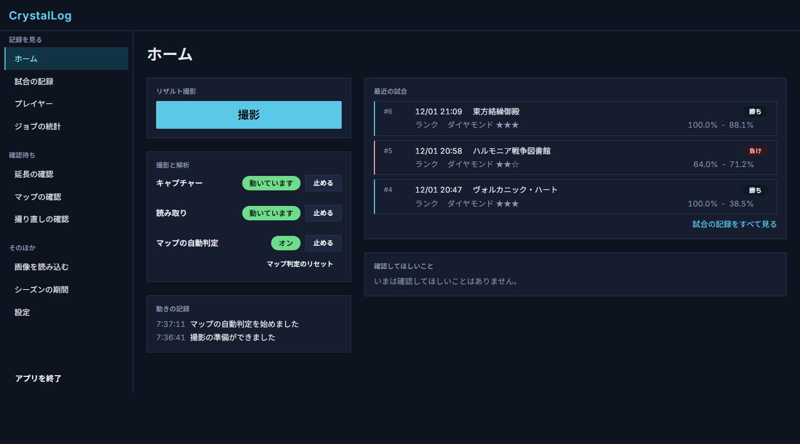

# CrystalLog

クリスタルコンフリクトのリザルト画面を撮って読み取り、試合の記録をPCの中にためていくアプリです。
勝ち負けやジョブごとの成績を、あとから見返せます。

## はじめにお読みください

- **非公式のアプリです。** 株式会社スクウェア・エニックスおよびFINAL FANTASY XIVの運営とは関係ありません。
  運営に問い合わせないでください。
- **使うのは自己責任です。** ゲームのメモリや通信には触れず、画面を撮って読み取るだけの作りですが、運営は外部ツールを
  認めていません。このアプリを使ったことで起きた損害やアカウントへの処分について、作者は責任を負えません。
- リザルト画面には、自分のほかに最大9人のプレイヤーの名前・ワールド・成績が出ます。このアプリはそれも記録します。
  ほかのプレイヤーが分かる形の画像やデータを、SNSや掲示板に載せないでください。ゲーム内でほかのプレイヤーを
  責める材料にも使わないでください。
- 記録はすべてあなたのPCの中に保存され、外へは送りません。アプリが外とやりとりするのは、画面を開いたときに
  このページから新しい版があるかを確かめる1回だけです(記録は送りません)。
- 無料です。寄付や広告は受け付けていません。

## 必要なPC

- Windows 11(64ビット)。Windows 10(64ビット)でも動く見込みですが、確かめていません。
- 画面の表示にはふだん使っているブラウザを使います。
- 空き容量: 撮った画像がたまるため、数百MB〜数GBに増えていきます。
- ゲームのUIの大きさ(キャラクターコンフィグの「UIサイズ」): 120%以上をおすすめします。100%でも動きます。
  それより小さいと正しく読み取れません。

## 入れ方

1. 右の「Releases」から、いちばん新しい `CrystalLog-Setup-x.y.z.exe` をダウンロードします。
2. ダウンロードしたファイルを開きます。
3. 「データの保存先」を聞かれたら、空き容量に余裕のあるドライブを選ぶのがおすすめです。
4. 入れ終わると、デスクトップとスタートメニューに「CrystalLog」ができます。

### 「WindowsによってPCが保護されました」と出たとき

このアプリには有料の署名が付いていないため、この表示が出ることがあります。「詳細情報」→「実行」で進めます。

### 「エラー 4551」で止まるとき

Windows 11の「スマート アプリ コントロール」が、署名の無いアプリを止めています。「Windows セキュリティ」→
「アプリとブラウザーの制御」→「スマート アプリ コントロール」をオフにすると入れられます。ほかの署名の無い
アプリも止められなくなるため、オフにするかはご自身で判断してください。

### ウイルス対策ソフトにファイルを消されたとき

署名が無いため、アプリの一部が誤って隔離されることがあります。「Windows セキュリティ」→「ウイルスと脅威の防止」
→「保護の履歴」で、CrystalLogのファイルを復元するか、入れ直してください。

## 使い方

1. 「CrystalLog」を開くと、ブラウザで画面が開きます。
2. 試合が終わってリザルト画面が出たら、`PrintScreen`キーを押すか、ホームの「撮影」を押します。
   `PrintScreen`キーは、ゲームが手前にあるときだけ撮ります。どちらも、ホームの「撮影と解析」で「自動撮影」が
   動いているときに使えます。
3. 撮った画像は自動で読み取られ、「試合の記録」に入ります。読み取りの間は少しPCが重くなることがあります。
   気になるときは、ホームの「撮影と解析」で読み取りを止め、試合の合間に動かしてください。
4. 延長やマップなど、画像から決められなかったことは、左の「確認待ち」に出ます。
5. 「プレイヤー」「ジョブの統計」で、ためた記録を見返せます。

他のアプリで記録していたデータがあれば、「設定」の「取り込み」から取り込める場合があります。

### 終わるとき

左のメニューのいちばん下の「アプリを終了」を押します。撮影と読み取りも止まります。ブラウザのタブを閉じるだけでは、
アプリは止まりません。

## 新しい版

新しい版が出ると、アプリの画面の上に知らせが出ます。ダウンロードして入れ直してください。保存先をそのままにして
進めれば、記録は引き継がれます。

## 消すとき

Windowsの「設定」→「アプリ」から消せます。記録したデータは消えずに残ります。入れ直すときに同じ保存先を選べば、
そのまま続きから使えます。

## 不具合を見つけたら

このページの「Issues」に書いてください。いつ・何をしていて・何が起きたかが分かると助かります。

Issuesは誰でも読めます。ほかのプレイヤーの名前が写った画像は載せないでください。保存先の `logs` フォルダの
ファイルは原因を調べるのに役立ちますが、PCのユーザー名などが入っていることがあるため、中を確かめてから
載せてください。返事や直すことを約束はできません。

---

FINAL FANTASY XIVは、株式会社スクウェア・エニックスの登録商標です。
